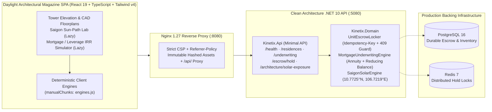

# Kinetix PropTech v3.0 — Full-Stack `.NET 10` Architectural Luxury Real Estate & Escrow Monorepo

> Flagship architectural real estate portal, astronomical Saigon Sun-Path & Daylight Exposure Lab, institutional mortgage / floating-rate DTI stress-test & 10-year leverage IRR engine, and compiled `.NET 10` idempotent unit escrow backend for **The Kinetix Residences · Thu Thiem Riverfront, Ho Chi Minh City**.

**Live Demo (Frontend SPA):** [https://tvt987.github.io/kinetix-proptech/](https://tvt987.github.io/kinetix-proptech/)

---

## System Architecture



---

## Core Engineering Capabilities (v3.0)

### 1. Frontend — Daylight Architectural Luxury Magazine (`src/`)
- **Editorial Design System**: Warm architectural paper (`#FAF8F4`), institutional Midnight Navy (`#0F1D36`), and Brushed Brass (`#B48A3E`) with `Cormorant Garamond` serif display, `Plus Jakarta Sans` body, and `JetBrains Mono` tabular numerals. Strict CSP & `Referrer-Policy` headers enforced; zero `dangerouslySetInnerHTML`/`innerHTML`/`eval`.
- **Interactive Tower Elevation & SVG CAD Floorplans**: Clickable vertical stack across Floors 18–42, multi-axis filtering, bespoke interior galleries, interactive room-by-room floorplan inspection, 3-unit side-by-side comparison matrix, persistent VIP Vault (`localStorage`), deterministic `KNX-2026-XXXX` VIP Pass with `.ics` calendar export, Techcombank NAPAS 247 VietQR refundable hold preview, and formal `@media print` A4 Investment Dossier.
- **Saigon Sun-Path & Daylight Orientation Lab (`solarPathEngine.ts` + lazy `SolarDaylightLab.tsx`)**:
  - Genuine NOAA/Spencer solar geometry calibrated for Thu Thiem, Ho Chi Minh City (`10.7725° N, 106.7219° E`, UTC+7).
  - `06:00–18:00` time-of-day slider, 4 astronomical seasons (Vernal/Autumn Equinox, Summer/Winter Solstice — modeling tropical northern zenith passage in June), and balcony orientation presets (`Unit Default`, `East 90°`, `South-East 135°`, `West 270°`, `North 0°`).
  - Live **Architectural Polar Compass + Rotated Residence Floorplan Sunlight Beam SVG** computing solar altitude/azimuth, direct sun penetration depth (`m`), exterior facade irradiance (`W/m²`), triple Low-E interior heat gain (`SHGC 0.36`, `2.2m` loggia overhang shading), and natural daylight illuminance (`lux`).
- **Mortgage Stress-Test & 10-Year Cash vs 70% Bank Leverage Simulator (`mortgageEngine.ts`, `leverageEngine.ts`)**:
  - Fixed-rate annuity PMT & full-term amortization down to exact `0 VND` balance + UTF-8 BOM Excel CSV, Markdown, and JSON dossier exports.
  - Floating-rate stress test (`+0%`, `+2%`, `+4%`) with private-banking DTI underwriting ratings (`<=35% SAFE`, `<=50% CAUTION`, `>50% HIGH_RISK`).
  - **Side-by-Side 10-Year Cash (0% LTV) vs Bank Leverage (50%/60%/70% LTV) Cashflow & Net IRR Matrix** incorporating rental escalation, management/maintenance fees, statutory 10% Vietnam rental tax, 2% exit transfer tax, Equity Multiple (MOIC), Capital Freed, and Leverage Alpha (`Net IRR` spread).
- **Code-Splitting**: `React.lazy` for `SolarDaylightLab`, `MortgageSimulator`, `ComparisonDrawer`, `ViewingSchedulerModal`, `VipVaultDrawer`, `ReservationDepositModal`, `PrintableDossier` paired with Vite `manualChunks` (`react`, `engines`).

### 2. Backend — Clean Architecture `.NET 10` Minimal API (`backend/`)
- **`backend/src/Kinetix.Domain/`**: Zero-dependency domain layer housing `MortgageUnderwritingEngine` (fixed-annuity + Vietnam bank reducing-balance schedule + DTI stress-test + 10Y IRR), `SaigonSolarEngine`, `ResidenceCatalog`, and `UnitEscrowLocker`.
- **`backend/src/Kinetix.Api/`**: Hardened ASP.NET Core 10 Minimal API exposing:
  - `GET /health`
  - `GET /api/v1/residences` & `GET /api/v1/residences/{id}`
  - `POST /api/v1/underwriting/stress-test`
  - `POST /api/v1/escrow/hold` (enforces mandatory `Idempotency-Key` header: `201 Created`, `200 OK` on idempotent replay, `409 Conflict` under concurrent double-hold race) & `GET /api/v1/escrow/holds/{holdId}`
  - `POST /api/v1/architecture/solar-exposure`
- **`backend/tests/Kinetix.Api.Tests/`**: Full xUnit + `WebApplicationFactory<Program>` suite verifying mortgage amortization math, `+4%` DTI breach, **10-way concurrent buyer unit-hold race returning strictly `1× 201 Created` + `9× 409 Conflict`**, and Saigon solar zenith accuracy across solstices/equinoxes.

---

## Documentation & Architecture Decisions

- **OpenAPI 3.1 Specification**: [`docs/openapi.yaml`](docs/openapi.yaml)
- **ADR-001**: [`docs/ADR-001-Idempotent-Unit-Escrow-Locking.md`](docs/ADR-001-Idempotent-Unit-Escrow-Locking.md) — Idempotent unit escrow locking & zero double-hold concurrency guard
- **ADR-002**: [`docs/ADR-002-Mortgage-DTI-RateStress-Underwriting.md`](docs/ADR-002-Mortgage-DTI-RateStress-Underwriting.md) — Dual-method mortgage underwriting, floating-rate DTI stress testing & 10-year leverage IRR

---

## Local Development & Docker Execution

### Run Full Stack via Docker Compose (Web + `.NET 10` API + PostgreSQL 16 + Redis 7)
```bash
docker compose up --build -d
# Web SPA + Reverse Proxy: http://localhost:8080
# .NET 10 API Health:      http://localhost:5080/health
```

### Run Local Tests & Production Builds
```bash
# 1. Frontend Unit Tests (Vitest)
npm ci
npm test

# 2. Frontend Type-Check & Code-Split Production Build
npm run build

# 3. Backend .NET 10 Clean Build & xUnit Integration Tests
dotnet test backend/Kinetix.sln
```

---

## Verification & Bundle Benchmark Summary

| Gate | Suite / Artifact | Result |
| --- | --- | --- |
| **Gate 1 — Frontend Tests** | Vitest (`5` files: mortgage, residence, currency/pass, vipProV2, solar/leverage) | **59 / 59 passed (100%)** |
| **Gate 2 — Frontend Build** | `tsc -b && vite build` (`React.lazy` + `manualChunks`: `react`, `engines`) | **0 errors** · Entry `index.js` `32.88 kB` gzip · `engines.js` `11.32 kB` gzip · `SolarDaylightLab.js` `5.12 kB` gzip |
| **Gate 3 — Backend `.NET 10`** | `dotnet test backend/Kinetix.sln` (`TreatWarningsAsErrors=true`, xUnit + `WebApplicationFactory`) | **23 / 23 passed (100%)** · `0` warnings · 10-way escrow race verified `1× 201` + `9× 409` |
| **Gate 4 — Headless E2E** | Playwright against `vite preview` at `1440×900` & `390×844` | **`0` console errors · `0` page errors · `0` failed requests · `0px` horizontal overflow** |

---

Architected & engineered by **Truong Van Tinh (TVT Studio)**.
