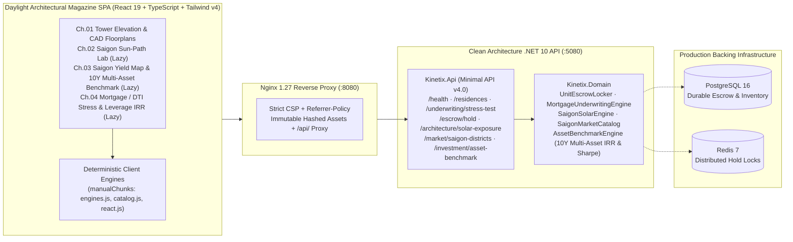

# Kinetix PropTech v4.0 — Architectural Luxury Real Estate, Saigon Metro/Yield Cartography, Multi-Asset Wealth Benchmark & `.NET 10` API

> Flagship architectural real estate portal, interactive **Ho Chi Minh City 6-Corridor Yield & Metro Line-1 / Thu Thiem Bridge-4 Cartographic Heatmap**, **10-Year Multi-Asset Wealth Benchmark Comparator** (70% LTV Sky-Residence vs Bank Deposit vs SJC Gold vs S&P 500 USD), astronomical **Saigon Sun-Path & Daylight Exposure Lab**, institutional mortgage / floating-rate DTI stress-test & 10-year leverage IRR simulator, and compiled **`.NET 10` Minimal API** for **The Kinetix Residences · Thu Thiem Riverfront, Ho Chi Minh City**.

**Live Demo (Frontend SPA):** [https://tvt987.github.io/kinetix-proptech/](https://tvt987.github.io/kinetix-proptech/)

---

## System Architecture



---

## Core Engineering Capabilities (v4.0)

### 1. Frontend — Daylight Architectural Luxury Magazine (`src/`)
- **Signature Editorial Design System**: Daylight Ivory architectural paper (`#FAF8F4`), institutional Midnight Navy (`#0F1D36`), and Brushed Brass (`#B48A3E`) with `Cormorant Garamond` serif display, `Plus Jakarta Sans` UI copy, and `JetBrains Mono` tabular numerals. Strict CSP & `Referrer-Policy` headers enforced; zero custom cursors, zero UI emojis, zero `dangerouslySetInnerHTML`/`innerHTML`/`eval`.
- **Ch. 01 — Interactive Tower Elevation & SVG CAD Floorplans**: Clickable vertical stack across Floors 18–42, multi-axis filtering, interior galleries, interactive room-by-room SVG CAD blueprint inspection, 3-unit side-by-side comparison matrix, persistent VIP Vault (`localStorage`), deterministic `KNX-2026-XXXX` VIP Pass with `.ics` calendar export, real Techcombank NAPAS 247 VietQR refundable hold preview, and formal `@media print` A4 Investment Dossier.
- **Ch. 02 — Saigon Sun-Path & Daylight Orientation Lab (`solarPathEngine.ts` + lazy `SolarDaylightLab.tsx`)**:
  - Astronomical solar geometry calibrated for Thu Thiem (`10.7725° N, 106.7219° E`, UTC+7) across `06:00–18:00` and all 4 seasons (Equinoxes & Solstices).
  - Live polar compass + rotated residence floorplan sunlight beam SVG modeling facade irradiance (`W/m²`), triple Low-E interior heat gain (`SHGC 0.36`, `2.2m` loggia overhang shading), sun penetration depth (`m`), and daylight illuminance (`lux`).
- **Ch. 03 — Saigon Luxury Corridor Yield & Metro Line-1 / Bridge-4 Cartographic Heatmap + 10-Year Multi-Asset Benchmark (`saigonDistrictEngine.ts`, `assetBenchmarkEngine.ts`, lazy `SaigonYieldMapLab.tsx`)**:
  - **Interactive Cartographic SVG Map** of Ho Chi Minh City's 6 premier residential corridors (*Thu Thiem Peninsula*, *District 1 Ben Nghe*, *Ba Son Marina*, *Binh Thanh Landmark*, *Thao Dien Riverside*, *Phu My Hung*) featuring the **Saigon River** bend, **Metro Line-1** stations, **Ba Son Bridge**, and **Thu Thiem Bridge-4** infrastructure spines.
  - Switchable choropleth heatmap layers (**5Y Catalyst CAGR**, **Net Rental Yield**, **Price/m²**) + Corridor Intelligence Dossier showing dual-currency **Price/m² (`VND` & `USD`)**, **Gross vs Net Rental Yield**, **Occupancy (`%`)**, **5Y Infrastructure Appreciation (`+%/yr`)**, and **CBD Commute (`min`)**.
  - **10-Year Multi-Asset Wealth Benchmark Comparator**: Deploys the buyer's exact down-payment capital (`5B–30B VND`) across **4 asset classes** — *Kinetix Leveraged Sky-Residence (70% LTV + Net Rental Cashflow)*, *Vietnam Bank Term Deposit (`5.8%/yr`)*, *SJC Physical Gold (`8.5%/yr`)*, and *S&P 500 USD Index (`9.5%/yr` + `2.2%/yr` VND FX Hedge)* — rendered via an interactive **SVG 10-Year Multi-Curve Wealth Trajectory Chart** with Year `1–10` inspection and exact **Net IRR, MOIC & Sharpe Ratio** (`Rf = 5.8%`) table.
- **Ch. 04 — Mortgage Stress-Test & 10-Year Cash vs 70% Bank Leverage Simulator (`mortgageEngine.ts`, `leverageEngine.ts`)**:
  - Fixed-rate annuity PMT & full-term amortization down to exact `0 VND` balance + UTF-8 BOM Excel CSV, Markdown, and JSON dossier exports.
  - Floating-rate stress test (`+0%`, `+2%`, `+4%`) with bank-grade DTI ratings (`<=35% SAFE`, `<=50% CAUTION`, `>50% HIGH_RISK`) and 10-Year Cash vs Leverage Net IRR matrix.
- **Code-Splitting**: `React.lazy` for `SolarDaylightLab`, `SaigonYieldMapLab`, `MortgageSimulator`, `ComparisonDrawer`, `ViewingSchedulerModal`, `VipVaultDrawer`, `ReservationDepositModal`, and `PrintableDossier` paired with Vite `manualChunks` (`react`, `catalog`, `engines`), keeping initial entry JS lean at **`< 80 kB`** raw (`~15 kB` gzip).

### 2. Backend — Clean Architecture `.NET 10` Minimal API (`backend/`)
- **`backend/src/Kinetix.Domain/`**: Zero-dependency domain layer housing `ResidenceCatalog`, `UnitEscrowLocker`, `MortgageUnderwritingEngine`, `SaigonSolarEngine`, `SaigonMarketCatalog`, and `AssetBenchmarkEngine`.
- **`backend/src/Kinetix.Api/`**: Hardened ASP.NET Core 10 Minimal API (`TreatWarningsAsErrors=true`) exposing:
  - `GET /health`
  - `GET /api/v1/residences` & `GET /api/v1/residences/{id}`
  - `POST /api/v1/underwriting/stress-test`
  - `POST /api/v1/escrow/hold` (mandatory `Idempotency-Key` header: `201 Created`, `200 OK` replay, `409 Conflict` under concurrent double-hold race) & `GET /api/v1/escrow/holds/{holdId}`
  - `POST /api/v1/architecture/solar-exposure`
  - `GET /api/v1/market/saigon-districts` (`?sortBy=yield|price|appreciation|commute`)
  - `POST /api/v1/investment/asset-benchmark`
- **`backend/tests/Kinetix.Api.Tests/`**: Full xUnit + `WebApplicationFactory<Program>` suite (`36` integration & domain tests, `0` warnings).

---

## Documentation & Architecture Decisions

- **OpenAPI 3.1 Specification (v4.0)**: [`docs/openapi.yaml`](docs/openapi.yaml)
- **ADR-001**: [`docs/ADR-001-Idempotent-Unit-Escrow-Locking.md`](docs/ADR-001-Idempotent-Unit-Escrow-Locking.md) — Idempotent unit escrow locking & zero double-hold concurrency guard
- **ADR-002**: [`docs/ADR-002-Mortgage-DTI-RateStress-Underwriting.md`](docs/ADR-002-Mortgage-DTI-RateStress-Underwriting.md) — Dual-method mortgage underwriting, floating-rate DTI stress testing & 10-year leverage IRR

---

## Local Development & Docker Execution

### Run Full Stack via Docker Compose (Web + `.NET 10` API + PostgreSQL 16 + Redis 7)
```bash
docker compose up --build -d
# Web SPA + Reverse Proxy: http://localhost:8080
# .NET 10 API Health:      http://localhost:5080/health
```

### Run Local Tests & Production Builds
```bash
# 1. Frontend Unit Tests (Vitest)
npm ci
npm test

# 2. Frontend Type-Check & Code-Split Production Build
npm run build

# 3. Backend .NET 10 Clean Build & xUnit Integration Tests
dotnet test backend/Kinetix.sln
```

---

## Verification & Bundle Benchmark Summary (v4.0)

| Gate | Suite / Artifact | Result |
| --- | --- | --- |
| **Gate 1 — Frontend Tests** | Vitest (`6` files: residence, mortgage, currency/pass, vipProV2, solar/leverage, saigonMarket & multiAssetBenchmark) | **83 / 83 passed (100%)** |
| **Gate 2 — Frontend Build** | `tsc -b && vite build` (`React.lazy` + `manualChunks`: `react`, `catalog`, `engines`) | **0 errors** · Entry `index.js` **`76.9 kB`** (`15.1 kB` gzip) · `SaigonYieldMapLab.js` `41.5 kB` (`10.4 kB` gzip) · `engines.js` `41.1 kB` (`15.7 kB` gzip) |
| **Gate 3 — Backend `.NET 10`** | `dotnet test backend/Kinetix.sln` (`TreatWarningsAsErrors=true`, xUnit + `WebApplicationFactory`) | **36 / 36 passed (100%)** · **`0` warnings** · 10-way escrow race + Saigon Market + 10Y Multi-Asset Benchmark verified |
| **Gate 4 — Headless E2E** | Playwright against `vite preview` at `1440×900` & `390×844` | **`0` console errors · `0` page errors · `0` failed requests · `0px` horizontal overflow** · Daylight Ivory `#FAF8F4` + Strict CSP + Cartographic Map + Multi-Asset SVG + Solar + VietQR verified |

---

Architected & engineered by **Truong Van Tinh (TVT Studio)**.
